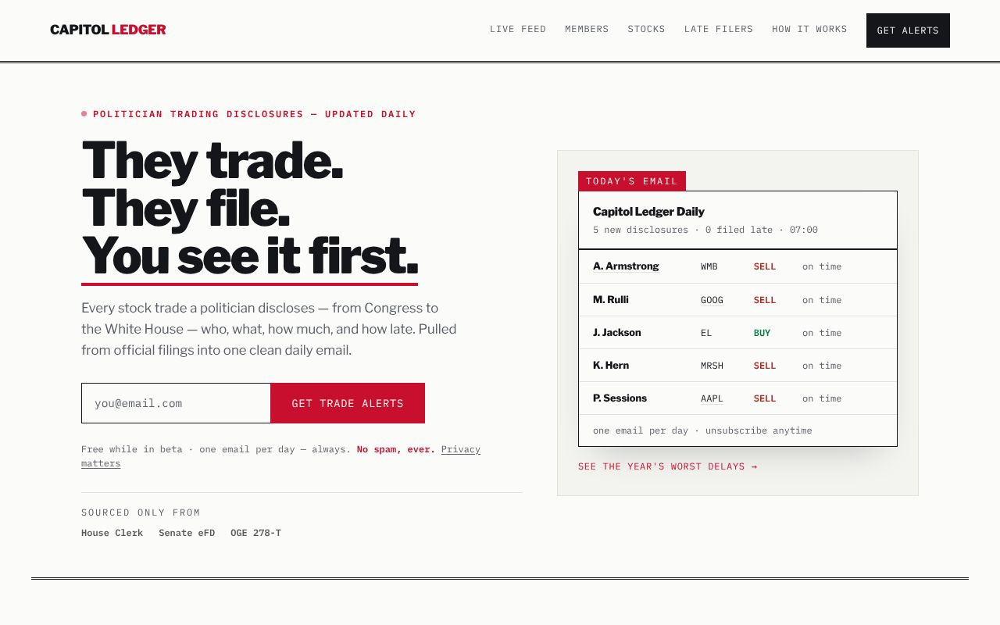
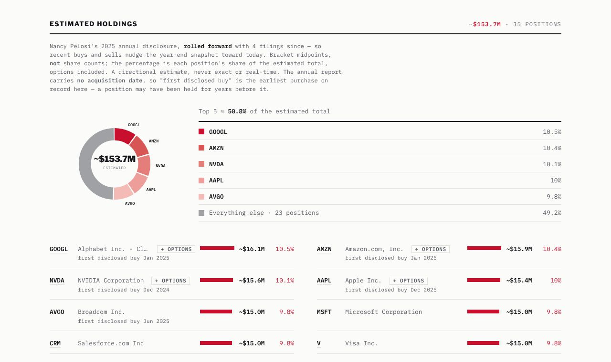
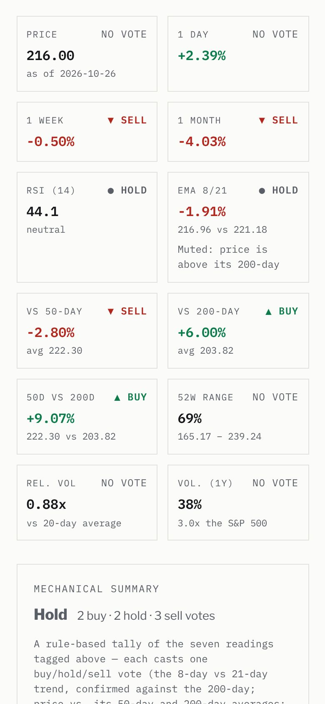
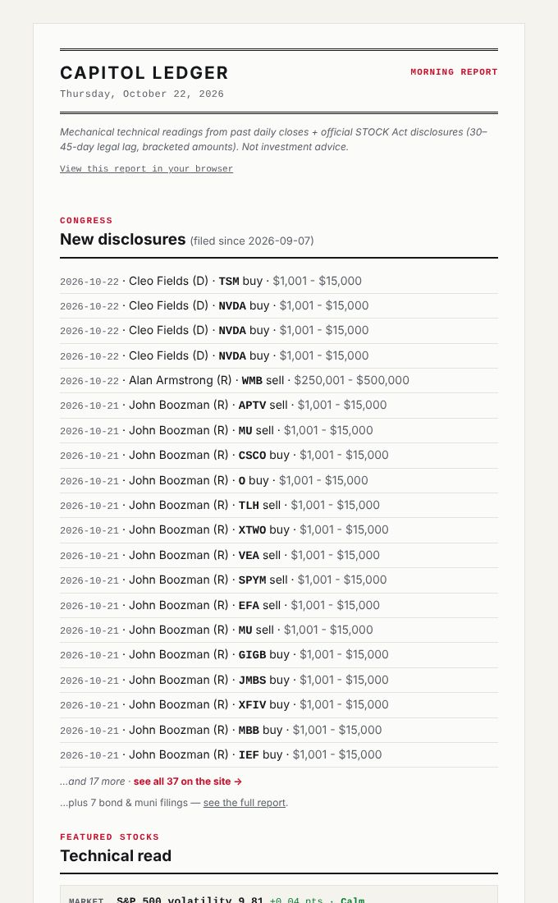

# Capitol Ledger

What members of Congress and the President buy and sell, from the official
filings, one morning at a time. Live at
**[capitolledger.io](https://capitolledger.io)**.



Every trade on the site comes from a government source: the
[Senate eFD](https://efdsearch.senate.gov), the
[House Clerk](https://disclosures-clerk.house.gov) and
[OGE](https://extapps2.oge.gov/201/Presiden.nsf) (the President's Form
278-T). Each row links to the filing it came from.

## How the data moves

```
Senate eFD ─┐
House Clerk ├─► congress/  ──► docs/data/*.json ──► landing/ ──► Vercel
OGE 278-T  ─┘   (Python)       (generated,          (Astro      capitolledger.io
                                committed daily)     static site)
                    │
                    └─► morning email (SMTP + Buttondown), GitHub issue,
                        X drafts (Typefully), IndexNow ping
```

One GitHub Action, [`congress-trades.yml`](.github/workflows/congress-trades.yml),
runs the whole chain once a day. A Raspberry Pi starts it at 09:00
Europe/Madrid ([`scripts/capitol-ledger-dispatch.sh`](scripts/capitol-ledger-dispatch.sh));
a GitHub cron at 08:20 UTC is the fallback and does nothing when the Pi
already ran. The Action commits the regenerated data, and Vercel rebuilds
the site from the commit.

The optional steps (holdings, prices, indicators, the emails, social drafts,
IndexNow) are non-fatal: a missing key or an outage skips the step and keeps
the previous file. One failing source does not stop the others, and a source
that keeps failing is named on the site and at the top of the morning email.

## What it looks like

| Member pages | Ticker pages (phone) | The morning email |
|---|---|---|
|  |  |  |
| Estimated holdings: the annual report rolled forward with later trades, at bracket midpoints. | Seven mechanical readings, each tagged with its vote, plus volatility against the S&P 500. | New disclosures first, then the featured scorecard. |

Screenshots of real data, made by `node scripts/readme_shots.mjs` after a
site build.

## What is where

| Path | What it holds |
|---|---|
| [`congress/`](congress/README.md) | The pipeline: fetchers, parsers, holdings, prices, technical indicators, the morning report, social drafts. Parsers are stdlib-only. |
| `docs/data/` | Generated data: trades, holdings, returns, performance, indicators, committees. Never edited by hand. |
| [`landing/`](landing/README.md) | The Astro + Tailwind site: home, `/tracker`, member and ticker pages, `/late`, `/report`. Pages build from `landing/src/data/`, which the pipeline writes. |
| `tests/congress/` | Offline tests for the pipeline. No network, no third-party packages. |
| [`ROADMAP.md`](ROADMAP.md) | The staged plan: storage, email tooling, follows. Stages wait for a trigger, not a date. |
| [`PRODUCT.md`](PRODUCT.md) | Who the product is for and what it must never claim. |
| [`CLAUDE.md`](CLAUDE.md) | The project rules and the reasons behind them. Read it before a change. |

## Quick start

```bash
# Pipeline tests (offline, Python 3.11, no installs needed)
python3 -m unittest discover -s tests/congress -p 'test_*.py'

# Fetch new filings without writing anything
pip install -r congress/requirements.txt
python3 -m congress fetch --limit 25 --dry-run

# Rebuild the site's data files from the committed trades
python3 -m congress landing

# Run the site locally (Node 20)
cd landing && npm install && npm run dev
```

`python3 -m congress --help` lists every command: `fetch`, `holdings`,
`prices`, `ai`, `landing`, `committees`, `social`, `indexnow`, `analytics`
and the rest.

## Secrets and variables

Set in GitHub under Settings → Secrets and variables → Actions. Everything is
optional except where noted; an unset value turns its feature off and the
run continues.

| Name | Kind | Turns on |
|---|---|---|
| `CONGRESS_PRICES_KEY` | secret | Twelve Data prices: return since buy, technical indicators, the volatility reading. |
| `SMTP_USER`, `SMTP_PASS` | secret | The morning email to the owner (Gmail address and app password). |
| `SMTP_HOST`, `SMTP_PORT`, `REPORT_EMAIL_TO`, `REPORT_EMAIL_FROM` | variable | Override the Gmail defaults and the recipient. |
| `BUTTONDOWN_API_KEY` | secret | The same email to confirmed subscribers. |
| `TYPEFULLY_API_KEY` + `SOCIAL_LIVE=true` | secret + variable | Unpublished X drafts for notable filings. Both are needed. |
| `SOCIAL_CAP` | variable | The most drafts in one run. |
| `VERCEL_TOKEN`, `VERCEL_PROJECT_ID`, `VERCEL_TEAM_ID` | secret or variable | The daily and weekly traffic emails. |
| `EARNINGS_DATES` | variable | `true` turns on the next-earnings date. Off by default: our Twelve Data plan does not serve that endpoint. |
| `SITE_URL` | variable | Leave unset. Only to point the email's links at a preview deployment. |

The site itself reads `PUBLIC_SIGNUP_ENDPOINT` (and the contact form's
`PUBLIC_CONTACT_ENDPOINT` / `PUBLIC_CONTACT_KEY`) from the Vercel project;
see [`landing/README.md`](landing/README.md).

## What the data can and cannot say

- The law lets a filing arrive 30 to 45 days after the trade. Nothing here is
  real-time.
- Amounts are the legal brackets ("$15K–$50K"), never exact values.
- Scanned paper filings cannot be read; the tracker lists them as skipped,
  with a link.
- Holdings are an estimate: the latest annual report, rolled forward with
  later trades, at bracket midpoints.
- The technical readings are a mechanical tally of public price data. Not
  investment advice.
